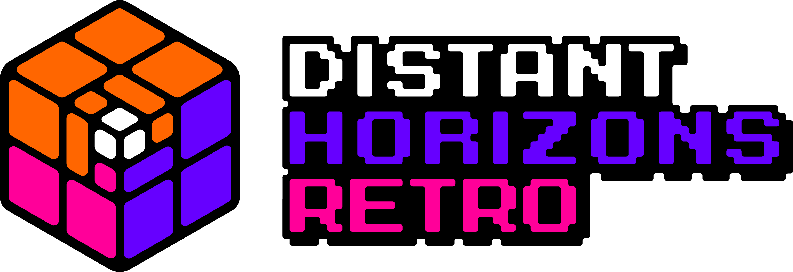
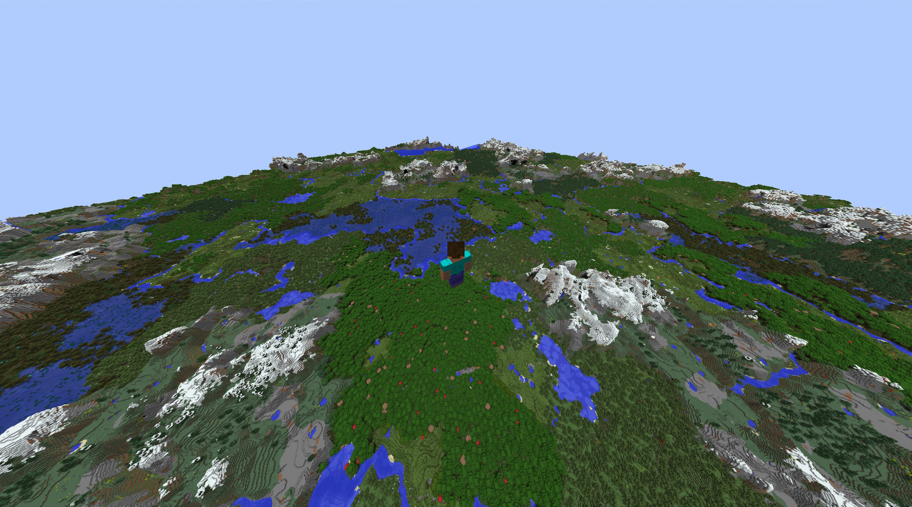

<p align="center">
  
</p>

<p align="center">
  A 1.7.10 / GTNH port of <a href="https://gitlab.com/distant-horizons-team/distant-horizons">Distant Horizons</a>, focused on optimized performance, stability and new features.
</p>

<p align="center">
  <a href="https://github.com/R-Besson/DistantHorizonsRetro/releases"></a>
  <a href="https://www.curseforge.com/minecraft/mc-mods/distant-horizons-retro"></a>
  <a href="https://github.com/R-Besson/DistantHorizonsRetro/releases"></a>
</p>

[//]: # (<a href="https://modrinth.com/mod/distant-horizons-retro"></a>)

# What is Distant Horizons Retro?

Distant Horizons Retro is a mod which implements a [Level of Detail](https://en.wikipedia.org/wiki/Level_of_detail_(computer_graphics)) system to Minecraft 1.7.10.\
This allows for far greater render distances without harming performance by gradually lowering the quality of distant terrain.



## Why Retro?

Distant Horizons Retro is a fork of [DistantHorizonsStandalone][standalone] by DarkShadow44, which
brought Distant Horizons to 1.7.10. DistantHorizonsStandalone tracks upstream Distant Horizons
updates. Distant Horizons Retro is **developed independently**. It doesn't sync with either project
and has its own roadmap:

- **Optimizations**: faster world generation and LOD building
- **Bug fixes**: LOD holes, crashes, mod compatibility and server stability
- **New features**: planned, specific to this fork

Please report issues with this mod [here](https://github.com/R-Besson/DistantHorizonsRetro/issues), not to Distant Horizons or DistantHorizonsStandalone.

# Installation

Download the latest version from [Releases](https://github.com/R-Besson/DistantHorizonsRetro/releases) and put it into your `mods` folder.

> [!WARNING]
> Remove any other Distant Horizons related .jar first.

> [!IMPORTANT]
> Make sure the latest versions of each dependency are installed:
> - [lwjgl3ify](https://github.com/GTNewHorizons/lwjgl3ify): 3.0.15 or higher
> - [GTNHLib](https://github.com/GTNewHorizons/GTNHLib)
> - [UniMixins](https://github.com/LegacyModdingMC/UniMixins)

## Shaders

Shaders are supported with [Angelica](https://github.com/GTNewHorizons/Angelica) 2.1.12 or higher.
Tested with [Complementary Shaders](https://modrinth.com/shader/complementary-reimagined) and [Euphoria Patches](https://modrinth.com/mod/euphoria-patches).

## GTNH

Older GTNH packs ship versions of Angelica, lwjgl3ify and GTNHLib that are too old. To upgrade them in Prism Launcher:

1. Download the latest [Angelica](https://github.com/GTNewHorizons/Angelica/releases), [lwjgl3ify](https://github.com/GTNewHorizons/lwjgl3ify/releases) (both the `.jar` and the `-multimc.zip`) and [GTNHLib](https://github.com/GTNewHorizons/GTNHLib/releases).
2. Delete the old `angelica-*.jar`, `lwjgl3ify-*.jar` and `gtnhlib-*.jar` from your `mods` folder.
3. Add the new jars and the Distant Horizons Retro jar to your `mods` folder.
4. Unzip `lwjgl3ify-*-multimc.zip` into your Prism Launcher instance. It should overwrite your `mmc-pack.json`.

# Roadmap

- [ ] Correct sky light and ceilings for modded dimensions (currently only the Nether is detected)
- [ ] Better block colors for GregTech, Chisel and other mods with custom textures
- [ ] Key bindings (toggle LODs, open config)
- [ ] Faster world generation and lower memory use

# Development

## Structure

```
DistantHorizonsRetro/
├── settings.gradle      # includeBuild('dh'), pins -PmcVer=1.7.10
├── build.gradle         # runs the mod build, copies jars to build/libs
├── .github/workflows/   # GTNH Actions
└── dh/                  # the mod
    ├── common/          # code shared between loaders
    ├── forge17/         # 1.7.10 Forge loader code
    └── coreSubProjects/ # core LOD engine
```

The code in `dh/` was originally imported from Distant Horizons, but it is now maintained here.
It is not synced from upstream.

## Build

```bash
./gradlew build # Jars land in build/libs
```

## Dev Client
```bash
./gradlew :dh:forge17:runClient # Run dev client (Java 25)
```

> [!TIP]
> Run with `-PdevProfile=true` for performance profiling and `-PdevJava8=true` for Java 8

# Credits

- [Distant Horizons][dh] by James Seibel and the Distant Horizons team
- [DistantHorizonsStandalone][standalone] by DarkShadow44, the original 1.7.10 port
- Logo based on the Distant Horizons logo by Pankakes

# License

Distant Horizons Retro is licensed under the LGPL, like Distant Horizons. See the `LICENSE*` files in `dh/`.

The Distant Horizons Retro logo is a modified version of the Distant Horizons logo © 2024 by Pankakes,
and like the original is licensed under [CC BY-SA 4.0](https://creativecommons.org/licenses/by-sa/4.0/).

<p align="center">
  
</p>

[dh]: https://gitlab.com/distant-horizons-team/distant-horizons
[standalone]: https://github.com/DarkShadow44/DistantHorizonsStandalone
