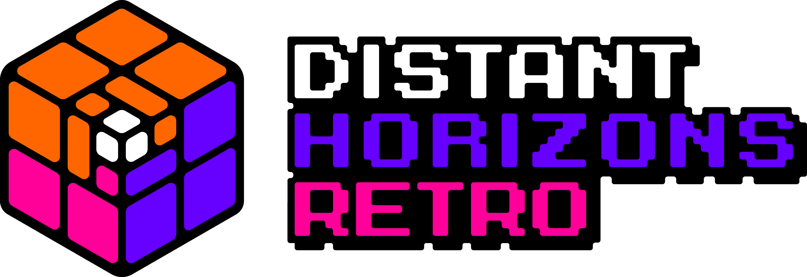
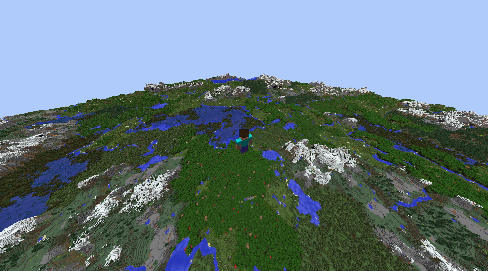

<p align="center">
  
</p>

<p align="center">
  Hyper Optimized Unofficial 1.7.10 fork of <a href="https://gitlab.com/distant-horizons-team/distant-horizons">Distant Horizons</a>, focused on visuals, performance, and new features.
</p>

<p align="center">
  <a href="https://github.com/R-Besson/DistantHorizonsRetro/releases"></a>
  <a href="https://github.com/R-Besson/DistantHorizonsRetro/releases"></a>
</p>

[//]: # (<a href="https://www.curseforge.com/minecraft/mc-mods/distant-horizons-retro"></a>)
[//]: # (<a href="https://modrinth.com/mod/distant-horizons-retro"></a>)

# What is Distant Horizons Retro?

Distant Horizons Retro is a mod which implements a [Level of Detail](https://en.wikipedia.org/wiki/Level_of_detail_(computer_graphics)) system to Minecraft 1.7.10.\
This allows for far greater render distances without harming performance by gradually lowering the quality of distant terrain.



## Why Retro?

Distant Horizons Retro is a fork of [GTNH Distant Horizons][gtnh] by DarkShadow44. Distant Horizons Retro is **developed independently**. It doesn't sync with either project and has its own [ROADMAP](#roadmap):

- **Optimizations**: faster world generation and LOD building
- **Bug fixes**: LOD holes, crashes, mod compatibility and server stability
- **New features**: planned, specific to this fork

Please report issues with this mod [here](https://github.com/R-Besson/DistantHorizonsRetro/issues), not to Distant Horizons or GTNH.

# Installation

Download the latest version from [Releases](https://github.com/R-Besson/DistantHorizonsRetro/releases) and put it into your `mods` folder.

> [!WARNING]
> Remove any other Distant Horizons related .jar first.

> [!IMPORTANT]
> Make sure the latest versions of each dependency are installed:
> - [lwjgl3ify](https://github.com/GTNewHorizons/lwjgl3ify): 3.0.15 or higher
> - [GTNHLib](https://github.com/GTNewHorizons/GTNHLib)
> - [UniMixins](https://github.com/LegacyModdingMC/UniMixins)

## Shaders

Shaders are supported with [Angelica](https://github.com/GTNewHorizons/Angelica) 2.1.12 or higher. Tested with [Complementary Shaders](https://modrinth.com/shader/complementary-reimagined) and [Euphoria Patches](https://modrinth.com/mod/euphoria-patches).

## Key bindings

Toggle LOD rendering and open the config from Options → Controls → Distant Horizons.

# Roadmap

- [x] Key bindings (toggle LODs, open config)
- [x] Faster LOD building, loading and saving
- [x] Correct ceilings for modded dimensions
- [x] Textured LODs, with and without shaders
- [x] Vanilla-like LODs: biome blended grass and leaves, see-through leaves, tall grass and flowers, depth shaded water
- [x] Fences, walls, slabs and snow layers shaped like the real blocks
- [x] Mobs visible up to the render distance with shaders
- [x] Better block colors for Chisel and other mods with connected textures (use the color override file for now)
- [x] Block shapes (fences, walls, slabs) work with shaders
- [x] Fog from other mods (GregTech pollution smog) hides LODs like vanilla terrain
- [x] Glowing LODs at night: smooth lighting, torches, lamps and glowstone that light up like vanilla
- [x] Cubic Chunks support
- [ ] Reliable multiplayer: the server generates and streams LODs to every player
- [ ] (?) Machines and block entities in LODs (GregTech machines, chests, AE2) with their textures
- [ ] (?) Detailed nearby LODs: stairs, panes, trapdoors, connected fences and walls
- [ ] (?) Multithreaded world generation, several times faster LOD generation


## Block colors

LOD colors are averaged from each block's texture. If a block looks wrong in the distance, set its color in
`config/DistantHorizonsBlockColors.cfg` (created on first launch), then press F3+T to reload:

```
# modid:block=RRGGBB applies to every meta, modid:block:meta=RRGGBB to one
minecraft:wool:14=A12722
# AARRGGBB also sets the alpha, 00 hides the block in LODs
minecraft:tallgrass=00000000
```

## Backups

LODs are stored in `DistantHorizons.sqlite` files next to each dimension's data, which can grow to several GB. They're a cache and can be deleted at any time, so they don't need to be backed up:

- Store them outside the world: set `databaseFolderOverride` in `config/DistantHorizons.toml`, IE to `DistantHorizonsData`. Each world and dimension gets its own folder in there. Existing LODs aren't moved.
- Or exclude them from your backups. With ServerUtilities, add these to the backup exclusion list (servers keep the world in `world/`, singleplayer in `saves/<world name>/`):
  ```
  **/DistantHorizons.sqlite
  **/DistantHorizons.sqlite-wal
  **/DistantHorizons.sqlite-shm
  ```
  The `-wal` and `-shm` files are SQLite's write-ahead log, they exist while the world is open.

## Using it in GTNH packs

This is NOT an official GTNH mod and isn't supported by the GTNH team, report issues here.

Older GTNH packs ship versions of Angelica, lwjgl3ify and GTNHLib that are too old. Use a daily build of GTNH instead.

# Development

## Structure

```
DistantHorizonsRetro/
├── settings.gradle      # includeBuild('dh'), reads the version from git
├── build.gradle         # runs the mod build, copies jars to build/libs
├── .github/workflows/   # build and release workflows
└── dh/                  # the mod
    ├── common/          # Minecraft-facing code (wrappers, rendering)
    ├── forge17/         # Forge entrypoint and mixins
    └── coreSubProjects/ # core LOD engine and API
```

The code in `dh/` was originally imported from Distant Horizons, but it is now maintained here. It is not synced from upstream.

## Build

```bash
./gradlew build # Jars land in build/libs
```

## Dev Client

```bash
./gradlew :dh:forge17:runClient # Run dev client (Java 25)
```

The dev client comes with [Angelica](https://github.com/GTNewHorizons/Angelica), Complementary Unbound with [Euphoria Patches](https://modrinth.com/mod/euphoria-patches) (select it in the shader pack menu)
[Twilight Forest](https://github.com/GTNewHorizons/twilightforest) for testing a modded dimension and [Chisel](https://github.com/GTNewHorizons/Chisel) for testing connected textures. Gradle downloads them, no manual setup needed.

> [!TIP]
> Run with `-PdevProfile=true` for performance profiling, `-PdevJava8=true` for Java 8
> and `-PdevMods=false` to leave out the test mods
> and `-PdevCubicChunks=true` to add CubicChunks to the dev client

# Credits

- [Distant Horizons][dh] by James Seibel and the Distant Horizons team
- [GTNH Distant Horizons][gtnh] by DarkShadow44, the original 1.7.10 port
- Logo based on the Distant Horizons logo by Pankakes

# License

Distant Horizons Retro is licensed under the LGPL, like Distant Horizons. See the `LICENSE*` files in `dh/`.

The Distant Horizons Retro logo is a modified version of the Distant Horizons logo © 2024 by Pankakes, and like the original is licensed under [CC BY-SA 4.0](https://creativecommons.org/licenses/by-sa/4.0/).

<p align="center">
  
</p>

[dh]: https://gitlab.com/distant-horizons-team/distant-horizons
[gtnh]: https://github.com/GTNewHorizons/DistantHorizons
